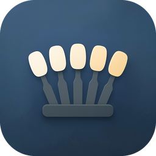
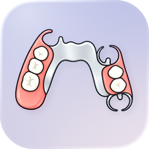

<picture>
  <source media="(prefers-color-scheme: dark)" srcset="https://capsule-render.vercel.app/api?type=waving&color=0:26215C%2C100:0b1020&height=200&section=header&text=Hi%2C%20I%27m%20Ahmed&fontColor=ffffff&fontSize=52&fontAlignY=36&desc=Prosthodontist%20By%20Profession%20%C2%B7%20Developer%20By%20Passion&descSize=17&descAlignY=58&animation=fadeIn"/>
  <source media="(prefers-color-scheme: light)" srcset="https://capsule-render.vercel.app/api?type=waving&color=0:EEEDFE%2C100:CECBF6&height=200&section=header&text=Hi%2C%20I%27m%20Ahmed&fontColor=26215C&fontSize=52&fontAlignY=36&desc=Prosthodontist%20By%20Profession%20%C2%B7%20Developer%20By%20Passion&descSize=17&descAlignY=58"/>
  
</picture>

 

<table>
<tr>
<td align="center" valign="top" width="33%">
 
 
<b>TrueShade</b>  

  
</td>
<td align="center" valign="top" width="33%">
 
 
<b>Claspr</b>  
 
  
</td>
<td align="center" valign="top" width="33%">
 
 
<b>RAIDnGo</b>  

  
</td>
</tr>
</table>

<b>LANGUAGES</b> 

<b>iOS AND ANDROID</b> 

<b>BACKEND AND DATA</b> 

<b>SECURITY AND REVERSE ENGINEERING</b> 

 

THANKS FOR STOPPING BY

<picture>
  <source media="(prefers-color-scheme: dark)" srcset="https://capsule-render.vercel.app/api?type=waving&color=0:0b1020%2C100:26215C&height=100&section=footer"/>
  <source media="(prefers-color-scheme: light)" srcset="https://capsule-render.vercel.app/api?type=waving&color=0:CECBF6%2C100:EEEDFE&height=100&section=footer"/>
  
</picture>

